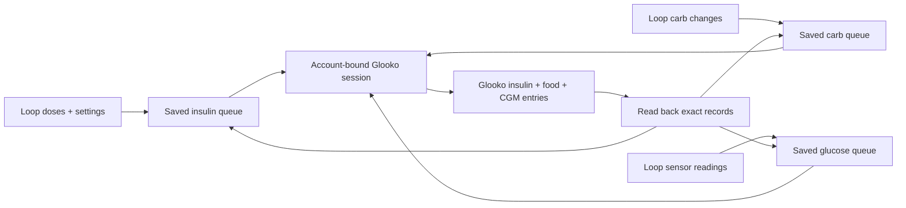
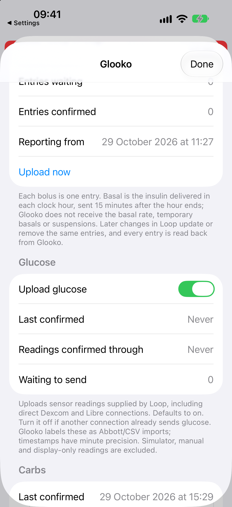

# GlookoService — Loop → Glooko

GlookoService is a reporting plugin for Loop. It sends **sensor glucose**, **delivered pump insulin** and **carbohydrate entries** to an EU-hosted Glooko account.

**Use `main` from this repository with Loop and LoopKit `next-dev`.** The async next-dev integration and insulin-name support are part of `main`.

Glucose uploads default to **on** and can be disabled independently. The service does not deliver insulin, change therapy settings or accept remote treatment commands. It uses Glooko’s patient-app session API; it is an unofficial integration, not Glooko’s official uploader.

## Contents

- [What it sends](#what-it-sends)
- [Build and install](#build-and-install)
- [Connect your account](#connect-your-account)
- [How uploads work](#how-uploads-work)
- [Insulin names and Loop attribution](#insulin-names-and-loop-attribution)
- [When data appears](#when-data-appears)
- [Find and verify your data](#find-and-verify-your-data)
- [Troubleshooting](#troubleshooting)
- [Credentials, privacy and removal](#credentials-privacy-and-removal)
- [Limits and historical uploads](#limits-and-historical-uploads)
- [Developer reference](#developer-reference)
- [Verification](#verification)

## What it sends

| Loop data | What Glooko receives | What is left out |
|---|---|---|
| Finished pump bolus | One delivered bolus entry, using delivered units when available | Automatic/manual pump-bolus distinction, recommendation details and the original programmed amount |
| Basal and temporary basal delivery | Delivered units aggregated into each clock hour | Basal-rate profiles, temporary-basal intervals, suspension/resumption events and zero-delivery hours |
| Carb entry | A standalone food entry containing grams and its timestamp | Meal classification, food description, absorption time and other nutritional information |
| Insulin selection | A text name such as `Fiasp via Loop`, attached to the corresponding delivery | A structured association with Glooko’s medication catalogue |
| Sensor glucose, including direct Dexcom and Libre connections | CGM readings through the LibreView CSV importer, with minute timestamps and values to 0.01 mg/dL | Native sensor attribution, trend/rate metadata, manual, display-only, qualified and simulator readings |
| Therapy settings and pump status | Local context for identifying the source, timing and insulin selection | Uploading settings or registering a new pump in Glooko |

Manually entered insulin doses in Loop are excluded. The pump simulator and sources without an identifiable real pump are excluded from insulin reporting. Carb and glucose uploads remain independent of pump eligibility. Glucose is taken from the readings supplied by Loop; using a manufacturer app is not required. Glooko labels this route **Abbott/CSV**, including when the readings came from Dexcom. This limitation is shown in the setup and status screens.

## Build and install

This repository builds a plugin, not a standalone iPhone app. It must be included in a compatible Loop workspace.

Requirements:

- Loop, LoopKit and their dependencies from a matching **next-dev** workspace.
- An EU-hosted Glooko account. There is no region selector; other regions and two-factor sign-in are not implemented.
- A real pump that Loop can identify for insulin reporting. A simulator is sufficient for the UI and carb workflow.
- The plugin’s Xcode targets require iOS **17.6 or later**. The documented build was exercised with Xcode **27.1**.

Start with [Loop’s Mac/Xcode build instructions](https://loopkit.github.io/loopdocs/build/overview/) for signing and device setup. Then follow the [workspace and host integration guide](Documentation/Loop/README.md).

A typical directory layout is:

```text
Loop development/
├── LoopWorkspace/
│   ├── LoopWorkspace.xcworkspace
│   ├── Loop/
│   ├── LoopKit/
│   └── …
└── GlookoService/
    └── GlookoService.xcodeproj
```

Add `GlookoService.xcodeproj` to the workspace and `GlookoServiceKitPlugin` to the **LoopWorkspace** scheme’s Build action. Build that workspace scheme so the matching LoopKit products and plugin are built together.

The host must query restored services and publish device metadata after restoring its device managers. The integration guide includes a patch for those next-dev requirements. Its older `dev` patch is historical and is not the current installation path.

After installation, **Glooko** should appear under Loop **Settings → Add Service**. If it is absent, check the workspace, scheme and embedded plugin before trying to sign in.

## Connect your account

1. Open **Settings → Add Service → Glooko** in Loop.
2. Enter the credentials for your EU Glooko account.
3. Choose whether to enable **Upload insulin**. It defaults to **off** for a new installation; carb foods are independent.
4. Leave **Upload glucose** on to report Loop’s sensor readings, or turn it off if another connection already uploads them to Glooko. The switch defaults to **on**, including when upgrading a version without this option.
5. Choose **Allow cellular data** if wanted. New installations default to Wi-Fi-only requests and do not use constrained/Low Data Mode networks.
6. Decide whether to enable **Remember password for session recovery**. Without it, the service saves the session and asks you to sign in again when recovery is needed.
7. Choose **Send history from**. It defaults to now and allows up to seven days back, subject to the history Loop still holds.
8. Tap **Sign in**. Open the saved service to see its status, queues and diagnostics.

Reconnecting an account with retained local history resumes its existing reporting period. A new date selection does not silently discard that saved history or start it over.

<table>
<tr><th>Account setup</th><th>Upload and history choices</th></tr>
<tr>
<td></td>
<td></td>
</tr>
</table>

*Actual captures from the existing iPhone 18 Pro simulator. These setup images predate the glucose switch; the current Glucose section is shown below. Account fields are empty. Outer Loop navigation can differ between builds.*

## How uploads work



The service saves incoming source changes before acknowledging them to Loop. Insulin preparation waits for **both** the dose and settings queries to finish. A page containing data is not treated as a finished query.

Finished boluses become individual records. Basal delivery is integrated into clock-hour quantities, using measured delivered volume when available. A running or mutable delivery can hold back an unfinished hour.

The local queues retain responsibility until Glooko returns the expected records. An accepted HTTP request alone is not confirmation. Readback checks each insulin record’s identity, amount, timestamp, delivery kind, medication/device flags and uploaded name.

Records have stable identifiers. Retrying updates the same record rather than intentionally creating another copy. Changes and deletions from Loop are staged against those identities. If a deleted insulin entry is needed again, it receives a new revision because Glooko does not revive its deleted GUID.

Carbs use their own queue and retry path. Editing a carb entry updates the same food identity; deleting it soft-deletes that food. Failed carb uploads can retry without another source change. **Upload now** also retries carbs when insulin reporting is disabled or blocked.

Glucose has a separate persistent queue. It waits for the glucose source query to finish, checks for existing readings, then submits missing readings as a LibreView-format CSV. Confirmation requires the expected value in **both stored CGM records and graph data**. Replaying an accepted reading does not intentionally upload another copy. A conflicting or duplicate minute is reported for review rather than overwritten.

Open **Settings → Glooko → Glucose → Upload glucose** to stop or resume this stream. Turning it off cancels its active request and retries, preserves queued readings and leaves insulin and carbs enabled according to their own settings. It cannot retract a request already accepted by Glooko or remove existing server data. The choice survives restarting Loop. After re-enabling, retained work resumes; further source history arrives through Loop’s normal queries.



*Actual simulator capture of the restored glucose feature. Zero confirmations are expected here because CGM Simulator readings are excluded. Positive upload checks are recorded under Verification.*

## Insulin names and Loop attribution

The service uses the insulin recorded on the original dose. If it is missing, it can use the settings snapshot applicable to that delivery time. It does not apply today’s selection to old doses.

| Available source information | Uploaded name |
|---|---|
| Fiasp | `Fiasp via Loop` |
| Humalog | `Humalog via Loop` |
| Novolog | `Novolog via Loop` |
| Two known insulins contributing to one basal hour | `Fiasp / Humalog via Loop` |
| Known and unknown contributions in one hour | `Fiasp / unknown insulin via Loop` |
| No recoverable insulin name | `Insulin via Loop` |

Names follow Loop’s selection. The service does not guess regional branding or insulin concentration. A settings fallback spanning a drug change remains unknown.

The name is **text**, not a Glooko catalogue medication. Catalogue-linked rapid-acting drugs reclassified test basal entries as bolus, so the service deliberately leaves the medication reference empty.

For example, a **synthetic** delivered-basal record contains:

```json
{
  "name": "Fiasp via Loop",
  "insulinType": "basal",
  "medicationGuid": null,
  "deviceDelivered": 1,
  "value": 0.73
}
```

The separate external identifier is also namespaced to Loop. Neither field registers an official Loop device in Glooko’s device catalogue. **Omnipod 5 via Loop** on the service’s status page is Loop’s description of the source; it is not a new Glooko device registration.

Glooko controls its own row layout and punctuation. The uploader supplies the name; it does not render or customise Glooko’s Daily log.

Older generic entries retained locally are queued for name updates using their existing identifiers, quantities and timestamps. Missing historical names remain unknown. This is not a global rewrite of every older record in the Glooko account.

## When data appears

| Data | Earliest eligibility | Additional conditions |
|---|---|---|
| Bolus | 10 minutes after it finishes | It must be final, within the reporting period and from an eligible source |
| Basal hour | 15 minutes after the hour ends | Delivery evidence must reach the hour end; mutable data can delay it |
| Carbs | After Loop delivers the saved change | No insulin settling delay; connection and retry state still apply |
| Glucose | After the glucose source query finishes | Upload glucose must be on; the reading must pass source and conflict checks |

Automatic insulin attempts are throttled to a **15-minute interval** and are driven by Loop’s source activity. They are not a guarantee of delivery at an exact wall-clock time. **Upload now** bypasses that throttle, but not source-query completion, settling or mutable-delivery checks.

Glucose does not use the insulin settling delay or 15-minute throttle. Pending readings are submitted in batches of up to 500. Failed attempts retry from 30 seconds, increasing to a maximum 15-minute delay while Loop can execute. **Upload now** also retries glucose when enabled.

Example: reporting starts at **08:20**, and a bolus finishes at **08:25**. That bolus is eligible from **08:35**. The partial basal hour **08:20–09:00** is eligible from **09:15**, if its delivery evidence is final.

iOS can suspend Loop’s execution. Network availability, Wi-Fi-only settings, authentication and source activity can add delay. Keep Loop operating normally; this plugin does not replace Loop’s own background-operation requirements or not-running alerts.

## Find and verify your data

In Glooko, use **Daily log** for insulin and food entries. Carb-only entries are standalone foods; the web Diet panel can remain empty for them. Use the glucose graphs for uploaded CGM readings and include the **Abbott/CSV** source when filtering data. This source label comes from Glooko’s LibreView importer; it does not identify the original sensor manufacturer. Disable this plugin’s glucose uploads if a separate CGM connection already supplies the same readings.

Glooko [distinguishes device-delivered and manually entered insulin](https://support.glooko.com/hc/en-gb/articles/360001739738-How-is-my-insulin-data-displayed-in-the-Glooko-app). These uploads set the device-delivery flag. That does not provide a full pump timeline, a settings report or an official Loop integration.

In Loop, open **Settings → Glooko**:

- **Last sent** records submission activity.
- **Last confirmed** records a successful record readback.
- **Entries waiting** counts prepared entries still needing confirmation. It does not count every unfinished dose that may become eligible later.
- **Basal ready through** shows the current delivery-evidence and settling horizon. It is not proof of preparation or upload. **Basal confirmed through** records acknowledged hourly coverage.
- Carb and glucose confirmation and waiting counts are shown separately. The glucose switch is in the **Glucose** section, below insulin status.

<table>
<tr><th>Upload status and controls</th><th>Independent readback</th></tr>
<tr>
<td></td>
<td></td>
</tr>
</table>

*These screenshots use a simulator and an isolated test account. Simulator insulin is excluded. A successful check comparing zero confirmed insulin entries is a connection check, not evidence that insulin was uploaded.*

### What Check Glooko now proves

**Diagnostics and live check → Check Glooko now** fetches Glooko’s insulin and CGM records again and compares locally confirmed entries with the server. Glucose counts show expected, stored and graphed readings, plus duplicate minutes. It does not send data, advance acknowledgements or certify the whole Glooko account.

Check the date and counts. “Every confirmed insulin entry matched” with **0 matched** is not evidence of a dose transfer. The same applies to zero expected glucose readings. Nor does a successful record check prove that every Glooko dashboard or clinic report uses the same source-selection rules.

Diagnostics also show source callbacks, query completion, prepared queues, confirmation times and recent request results. The service retains up to **250 events for 48 hours**. Request traces omit headers, query parameters, bodies, passwords and cookies.

The share control exports a diagnostic report. It still contains health-data timings, counts and errors; review it before sharing.

## Troubleshooting

| What you see | Meaning and next step |
|---|---|
| Glooko missing from Add Service | Recheck the workspace project, scheme build target and plugin embedding |
| Signed in, but zero entries | Check the reporting start, settling windows, source-query completion and whether any eligible delivery exists |
| Pump Simulator / unknown source excluded | Expected insulin guard. Use a real pump for insulin reporting; simulator carbs can still exercise the food route |
| No pump connected after relaunch | Check the host integration’s restored-device snapshot; do not disguise the source by changing a manufacturer string |
| Waiting for source history/settings | The host must finish both queries, including their empty drain callbacks; see the host integration guide |
| Session expired / sign-in needed | Use Sign in again. Optional password recovery cannot handle every account or authentication challenge |
| Wi-Fi-only and nothing moves | Wait for Wi-Fi or explicitly enable cellular; constrained/Low Data Mode networking remains disabled |
| Accepted but not confirmed | The queue stays pending. Inspect readback/request results; an HTTP success is insufficient |
| Glucose switch missing | Install a build containing this feature, then open Settings → Glooko and scroll to Glucose |
| Glucose appears as Abbott/CSV with a Dexcom sensor | Expected importer attribution; the CSV route cannot preserve native sensor identity |
| Glucose waiting or conflicting minute | Check query completion, network, and diagnostics. A different or duplicated server reading is not overwritten. Check other connected uploaders |
| Food visible but Diet empty | Standalone carb foods can appear in Daily log/Graphs without populating the Diet panel |
| Older summaries differ | Inspect the date range and older imported sources. This plugin does not certify or repair all historical Glooko aggregates |

### Alerts

The service can issue Loop alerts for authentication needing attention, paused history, overdue eligible submissions and delayed confirmation. The overdue threshold defaults to **one hour**, with choices in the service settings.

Settling and intentionally disabled streams are not themselves overdue uploads. Alerts are deduplicated and resolved alerts are retracted when the condition clears. Their background delivery depends on Loop, iOS and notification permissions.

**Send test alert** checks Loop’s alert presentation. It does not deliberately expire an account or report a real upload failure.

## Credentials, privacy and removal

New sign-ins save a session. Password retention is opt-in through **Remember password for session recovery**. Existing installations retain their recovery setting until changed. **Forget stored password** removes the saved recovery password.

Credentials are account-scoped in iOS Keychain, available after first unlock, device-only and not synchronised through iCloud. The optional password can be retrieved by this app and sent to Glooko again during session recovery.

There is no registered OAuth client in this project. Login uses Glooko’s patient-app session API. Credential rejection, account restrictions, MFA or an unavailable recovery secret can require interactive sign-in. Concurrent senders share recovery, and automatic password attempts are rate-limited.

Upload history and diagnostics are stored in the app’s protected, account-scoped storage. Switching to a new account uses separate local history. Storage read/decode failures are surfaced; acknowledged history is not silently replaced with an empty queue.

**Delete Glooko service** offers:

- **Disconnect and keep history:** stop the service and remove its credentials; retain upload history for reconnection.
- **Erase local data and remove:** after a second confirmation, remove this plugin’s local history, archives, diagnostics and credentials from the app.

Neither option erases Loop’s original source records or data already stored in Glooko. Disabling **Upload insulin** or **Upload glucose** retains that stream’s queued records; carb foods remain independent.

## Limits and historical uploads

- This is delivered-dose reporting, not a complete reproduction of Loop or a pump download. Glooko receives no basal-rate, temporary-basal, suspension, automation or therapy-settings timeline from this route.
- Zero-delivery hours are omitted. Both user-requested and automatic pump boluses are ordinary bolus entries in Glooko.
- Quantities are prepared to three decimal places. Glooko can round graph points and summary statistics further; raw record confirmation and displayed totals have different precision.
- Historical travel, time-zone changes and repeated local times around clock changes are not fully reconstructed. Do not assume complete historical timing fidelity across those cases.
- Only retained Loop history and locally retained upload records can be recovered. The local insulin and glucose queues retain recent history for about 14 days while protecting unconfirmed work.
- Previously imported records remain in Glooko. Duplicate data from independently connected uploaders is not automatically deduplicated across those separate routes.
- Glucose CSV timestamps have minute precision. Corrections and repeated local clock minutes with different offsets cannot be represented safely; conflicts stop acknowledgement of the affected source page. Sensor values are rounded to 0.01 mg/dL for transport, while original readings remain in local storage.
- Glucose source identity is Abbott/CSV in Glooko, even for Dexcom. A native source-preserving CGM write route has not been established. The tested patient API CGM PUT route returned “Not available”.
- Manual injection entries, meal descriptions, insulin concentrations and structured catalogue-drug links are not uploaded.
- Other Glooko regions, MFA and a public, supported OAuth write contract are not implemented. The patient-app API can change independently of this project.

Earlier versions used a virtual Omnipod/IBF compatibility route for insulin. **The active insulin service does not use that route.** Glucose now uses the LibreView CSV importer, with a new protected queue distinct from the retired glucose cache. The remaining Omnipod/IBF code supports old stored history and migration. Insulin cut-over starts at the previous route’s submitted boundary, or its unsubmitted history start, to avoid intentionally counting the same delivery twice. Older native pump records are not relabelled or amended by the new generic-entry path.

## Developer reference

| Path | Role |
|---|---|
| `GlookoKit/InsulinOutbox.swift` | Delivered-volume aggregation, persistent insulin queue, names, amendments and exact readback |
| `GlookoKit/GlucoseOutbox.swift` | Persistent CGM queue, replay/conflict checks, CSV submission, stored-record and graph readback |
| `GlookoKit/CarbOutbox.swift` | Source-owned food identities, changes, deletion, confirmation and older meal migration |
| `GlookoKit/GlookoClient.swift`, `SyncReader.swift` | Session transport and complete paginated reads |
| `GlookoKit/SyncHealth.swift`, `SyncDiagnostics.swift` | Alert state and bounded diagnostic history |
| `GlookoServiceKit/ReportingContext.swift` | LoopKit dose/settings adapter, source identity and recorded insulin name |
| `GlookoServiceKit/GlookoService.swift` | Lifecycle, account binding, query draining, upload scheduling and credential recovery |
| `GlookoServiceKitUI/` | Setup, status, controls and diagnostics |
| `GlookoServiceKitPlugin/` | Loop plugin discovery and principal class |
| `Tests/GlookoKitTests/` | Standalone core regressions |
| `Tests/GlookoServiceKitTests/` | Actual iOS service, persistence, Keychain and intercepted transport |
| `Documentation/Loop/` | Current next-dev host integration and historical dev patch |

### Request identity

Requests identify this project honestly:

```http
User-Agent: Loop-GlookoService (+https://github.com/Nutcasey/GlookoService)
```

The client sends no `deviceInformation` header or login-body field, fabricated device ID/serial, or Glooko application version, build number or Git hash. It does not add the Glooko website's `Origin` or `Referer`, including on glucose CSV uploads and the retained legacy file-upload helper. The login body contains the account credentials under the endpoint's `user` or `userLogin` key.

On **29 October 2026**, an isolated EU account accepted sign-in, basal and bolus writes, carb creation/amendment, retries, exact readback and confirmed deletions with this identity. All pre-existing insulin and food records remained unchanged. The restored glucose sender also uploaded two synthetic readings to the isolated account and verified both stored records and graphs, without creating duplicates on replay. The integration still uses Glooko's patient-app API, which can change independently of this project.

Current write routes are `PUT /api/v2/insulins`, `PUT /api/v2/foods` and, for glucose, `POST /api/v3/device/file/upload?extractorName=LibreviewCSV`. A sync-complete request follows submission. Legacy meal records can be retired during carb migration. Insulin files and virtual insulin-reporting devices are not the current insulin upload path.

For the standalone core:

```sh
swift test
```

For the iOS adapter, build the matching workspace products first, then run the **GlookoServiceTests** scheme on a simulator. Its dedicated host intercepts HTTP rather than contacting a real Glooko account. Simulated Keychain access requires an appropriately signed test host; ad hoc simulator signing was used for the documented run.

`project.yml` is the XcodeGen source. After adding source files, regenerate `GlookoService.xcodeproj` and include it in the change. The UI framework captures its own Git commit, dirty flag and build date; a `.dirty` label identifies an uncommitted build.

## Verification

Verification recorded on **29 October 2026**:

| Boundary | Evidence |
|---|---|
| Core | 42 passing tests; request identity, labels, original quantities, persistence and old-cache upgrades |
| iOS service | 14 passing integration tests; service-boundary checks cover default-on glucose, disabling and restart persistence, Dexcom/Libre units, source filtering, query draining, cancellation, retry and damaged storage alongside insulin/carbs |
| Isolated live API | Production uploader added names to existing GUIDs, replayed without duplicates, corrected a synthetic name and verified cleanup |
| Simulator workflow | Fresh sign-in, cancellation, alerts, carb creation/edit/deletion, repeated Upload now, restart recovery and simulator-insulin exclusion |
| Device integration | Clean `03af1ca` installed on the Ultimate iPhone; 20 existing confirmed insulin entries matched, with 0 missing/different |
| Glucose live API | Two synthetic readings accepted and matched in raw CGM records and graphs; replay produced no duplicates and all 12 pre-existing readings remained unchanged |
| Documentation UI | Real captures from the existing `loop` simulator, using empty setup fields and an isolated account |

The two synthetic CGM points are retained only in the isolated test account because individual CGM deletion through this importer is not established. No synthetic glucose is sent to the clinical account.

The [simulator validation record](.log/261029-1538-simulator-end-to-end-validation.md) gives the actual workflow and failure-test results. The carb cycle reused one Glooko food GUID through 27 g → 34 g → deletion; all 227 pre-existing insulin records and 14 pre-existing food records remained unchanged.

The [phone deployment record](.log/261029-1635-ultimate-iphone-deployment.md) covers installation of the current request identity and status fix on **29 October 2026**. The on-phone read-only check matched all 20 existing confirmed insulin entries. Reporting history, the real pump identity, insulin selection and reported therapy schedules/limits were preserved. The check verified existing records; new submissions continue on the normal upload cadence.

Tests of catalogue-associated rapid-acting insulin demonstrated unwanted basal-to-bolus reclassification. Text-only names with a null medication reference preserved both delivery kinds in raw records, graphs and the tested statistics.

These checks do not certify every pump, region, background state, historical date or Glooko report. Exact native Glooko row layout remains controlled by Glooko; the plugin’s verified contract is the uploaded record name and delivery data.

See the [work records](.log/) for implementation decisions and tested contracts, and [screenshot provenance](Documentation/Screenshots/README.md) for capture details.

## Licence and artwork

Code is available under the [MIT licence](LICENSE). Glooko and Loop names and artwork belong to their respective owners. The service icon comes from Glooko’s [App Store listing](https://apps.apple.com/gb/app/glooko-track-diabetes-data/id471942748); the unmodified Loop artwork notice is included in [LoopArtwork-LICENSE.txt](GlookoServiceKitUI/LoopArtwork-LICENSE.txt).
