# GlookoService — Loop → Glooko

GlookoService is a reporting plugin for [Loop](https://loopkit.github.io/loopdocs/). It sends your **sensor glucose**, **delivered pump insulin** and **carbs** from Loop to an EU-hosted Glooko account, so they appear alongside the rest of your diabetes data in Glooko and for your clinic.

- **Reporting only.** It never delivers insulin, changes therapy settings or accepts remote commands.
- **Checked, not assumed.** Every entry is read back from Glooko before Loop counts it as sent.
- **You choose what goes.** Insulin and glucose each have their own switch. Carbs are always sent.
- **Unofficial.** It uses Glooko's patient-app session API. It is not Glooko's own uploader, and Glooko can change that API at any time.

**Use `main` from this repository with Loop and LoopKit `next-dev`.**

<table>
<tr><th>Status at a glance</th><th>Dark mode</th></tr>
<tr>
<td>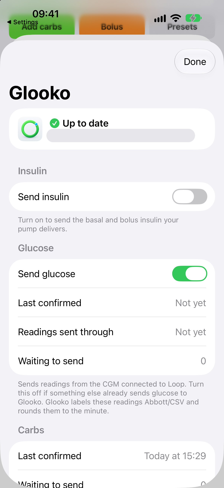</td>
<td>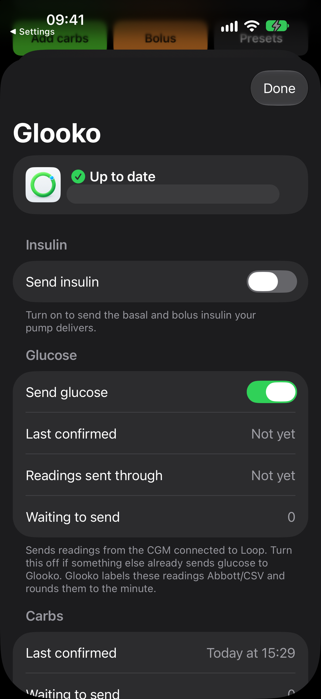</td>
</tr>
</table>

## Contents

- [What it sends](#what-it-sends)
- [Build and install](#build-and-install)
- [Connect your account](#connect-your-account)
- [The Glooko screen, section by section](#the-glooko-screen-section-by-section)
- [Diagnostics and Check Glooko now](#diagnostics-and-check-glooko-now)
- [Alerts](#alerts)
- [How uploads work](#how-uploads-work)
- [Insulin names and Loop attribution](#insulin-names-and-loop-attribution)
- [When data appears](#when-data-appears)
- [Find your data in Glooko](#find-your-data-in-glooko)
- [Troubleshooting](#troubleshooting)
- [Credentials, privacy and removal](#credentials-privacy-and-removal)
- [Limits and historical uploads](#limits-and-historical-uploads)
- [Developer reference](#developer-reference)
- [Verification](#verification)

## What it sends

| Loop data | What Glooko receives | What is left out |
|---|---|---|
| Finished pump bolus | One delivered bolus entry, using delivered units when available | Automatic/manual distinction, recommendation details and the original programmed amount |
| Basal and temporary basal delivery | Delivered units totalled for each clock hour | Basal-rate profiles, temporary-basal intervals, suspensions and zero-delivery hours |
| Carb entry | A standalone food entry with grams and time | Meal type, food description, absorption time and other nutrition |
| Insulin selection | A text name such as `Fiasp via Loop`, attached to each delivery | A link to Glooko's medication catalogue |
| Sensor glucose, including direct Dexcom and Libre connections | CGM readings through Glooko's LibreView CSV importer, to the minute and 0.01 mg/dL | Native sensor attribution, trend arrows, and manual, display-only, qualified and simulator readings |
| Therapy settings and pump status | Used locally to identify the source, timing and insulin | Nothing: settings are not uploaded and no pump is registered in Glooko |

What is never sent:
- **Excluded from insulin:** manually entered insulin doses, the Pump Simulator and sources without an identifiable real pump.
- **Excluded from glucose:** CGM Simulator readings.

Carbs and glucose don't depend on having a real pump. Glucose comes from the readings Loop already has, so you don't need the manufacturer's app. Glooko labels these readings **Abbott/CSV**, even when they came from a Dexcom; the setup and status screens say so.

## Build and install

This repository builds a plugin, not a standalone app. It must be included in a compatible Loop workspace.

Requirements:

- Loop, LoopKit and their dependencies from a matching **next-dev** workspace.
- An EU-hosted Glooko account. There is no region selector. Other regions and two-step sign-in are not supported.
- A real pump that Loop can identify, for insulin reporting. A simulator is enough for the screens, carbs and the connection check.
- iOS **17.6 or later**. The documented builds used Xcode **27.1**.

Start with [Loop's build instructions](https://loopkit.github.io/loopdocs/build/overview/) for signing and device setup, then follow the [workspace and host integration guide](Documentation/Loop/README.md).

A typical layout:

```text
Loop development/
├── LoopWorkspace/
│   ├── LoopWorkspace.xcworkspace
│   ├── Loop/
│   ├── LoopKit/
│   └── …
└── GlookoService/
    └── GlookoService.xcodeproj
```

1. Add `GlookoService.xcodeproj` to the workspace.
2. Add `GlookoServiceKitPlugin` to the **LoopWorkspace** scheme's Build action.
3. Build that scheme, so the matching LoopKit products and the plugin are built together.

The host must query restored services and publish device metadata after restoring its device managers. The integration guide includes a patch for those next-dev requirements. Its older `dev` patch is historical.

Once installed, **Glooko** appears under Loop **Settings → Services → Add Service**. If it doesn't, check the workspace, the scheme and that the plugin is embedded before trying to sign in.

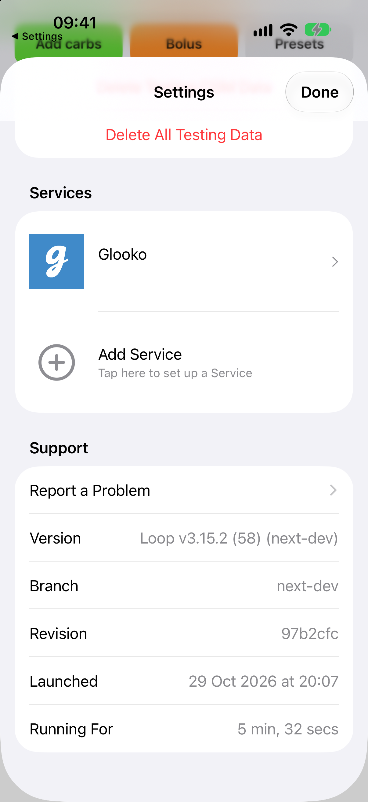

## Connect your account

Open **Settings → Add Service → Glooko** and work down the screen:

1. **Glooko account:** enter the email and password you use for Glooko.
2. **Save password on this iPhone** (off by default). Off, Loop keeps only the Glooko session and asks you to sign in again when it expires. On, the password is kept in this iPhone's Keychain and used to sign in again for you.
3. **What to send:**
   - **Insulin** is off by default for a new installation.
   - **Glucose** is on by default, including when upgrading from a version without it. Turn it off if something else already sends your glucose to Glooko.
   - Carbs are always sent.
4. **Use mobile data** is off by default, so Loop waits for Wi-Fi. Low Data Mode networks are never used.
5. **Send history from** defaults to now and goes back up to seven days, as far as Loop still has history. This option only appears on first setup.
6. Tap **Sign in**.

If you reconnect an account that still has local history, sending carries on from where it stopped. Choosing a new date doesn't discard or restart that history.

<table>
<tr><th>Account and what to send</th><th>Mobile data and sign in</th></tr>
<tr>
<td>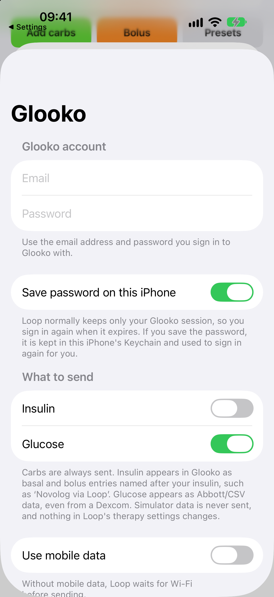</td>
<td>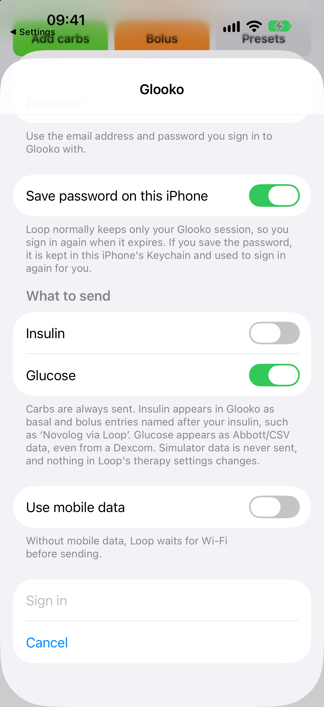</td>
</tr>
</table>

## The Glooko screen, section by section

Open **Settings → Glooko** at any time. Insulin, glucose and carbs are laid out the same way: the switch first, then when data was last confirmed, how far it has been sent, and what is still waiting.

### Status header

The top line answers "is it working?":

| Header | Meaning |
|---|---|
| ✅ **Up to date** | Nothing is waiting and nothing has failed |
| 🕒 **N waiting to send** | Data is queued and will go on the next send. This is normal for a few minutes, longer on Wi-Fi only |
| ⚠️ **Some data can't be sent** | A switched-on stream has an error. The warning sits in that stream's section |
| ⚠️ **Sign in needed** | The Glooko session expired. The reason and a **Sign in** button appear in the header |

The account email is shown underneath.

### Insulin

- **Send insulin:** sends pump-delivered boluses and hourly basal totals. While it's off, the section shows a single line saying what turning it on would send.
- **Pump:** the pump Loop is reporting from, such as *Omnipod 5*.
- **Last confirmed:** when Glooko last returned an entry exactly as sent.
- **Basal sent through:** the end of the latest confirmed basal hour.
- **Waiting to send:** entries prepared but not yet confirmed. Doses that are still settling and not eligible yet aren't counted.
- **Entries in Glooko:** confirmed entries for this account.
- **Last send:** the result of the most recent batch, for example *1 of 1 insulin entries confirmed in Glooko*. This counts one batch, not the total.

Insulin from the Pump Simulator or an unidentifiable pump is never sent. If insulin is on without a real pump, the section shows a warning and Loop raises an alert:

<table>
<tr><th>Insulin switched on without a real pump</th><th>The matching Loop alert</th></tr>
<tr>
<td>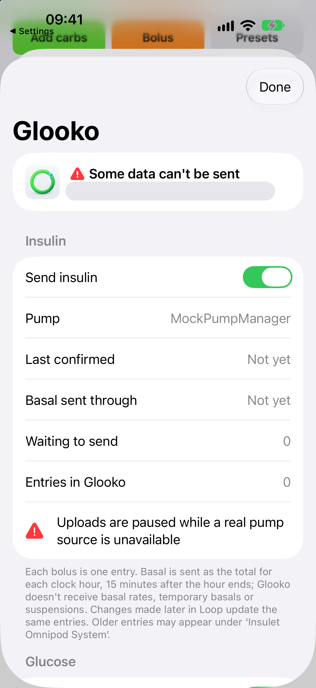</td>
<td>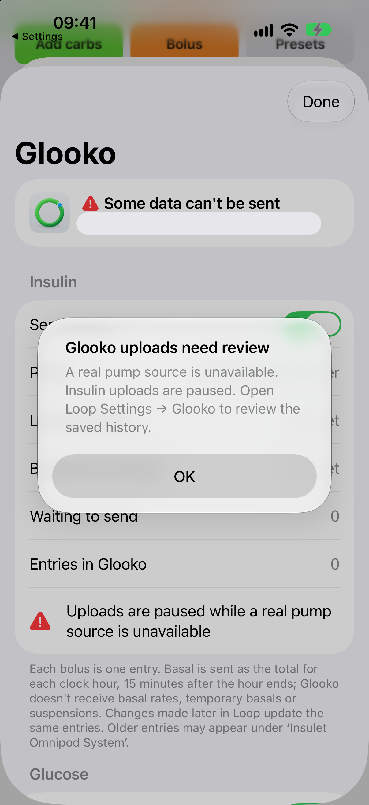</td>
</tr>
</table>

### Glucose

- **Send glucose:** sends readings from the CGM connected to Loop.
- **Last confirmed**, **Readings sent through** and **Waiting to send** work as they do for insulin.
- A **Last send** line reports the latest batch, for example *91 of 91 readings verified in Glooko records and graphs*.

Turning glucose off:
- cancels its active request and retries, and keeps queued readings;
- leaves insulin and carbs alone;
- is remembered when Loop restarts.

Turning it back on resumes the retained work. It can't take back a reading Glooko has already accepted.

### Carbs

Carbs are always sent, soon after you save them. **Last confirmed** and **Waiting to send** show their state. Editing a carb entry in Loop updates the same Glooko food entry, and deleting it deletes that entry.

### Sending

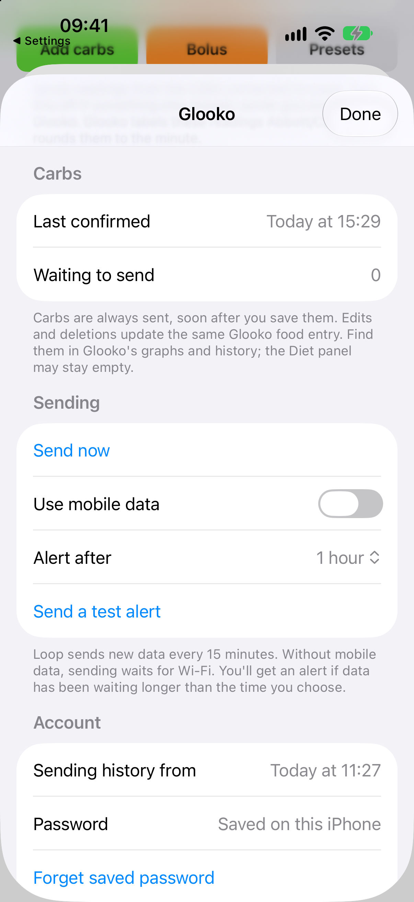

- **Send now:** sends everything that's ready, without waiting for the 15-minute cycle. It still respects settling times and source checks, and it retries carbs and glucose even when insulin is off or blocked.
- **Use mobile data:** without it, sending waits for Wi-Fi.
- **Alert after:** how long data may wait before Loop alerts you: 30 minutes, 1 hour (default), 2 hours or 4 hours.
- **Send a test alert:** shows a sample Glooko alert, so you can check notifications work. It reports no real problem.

### Account, Help and Delete

<table>
<tr><th>Account, Help and Delete</th><th>Delete choices</th></tr>
<tr>
<td>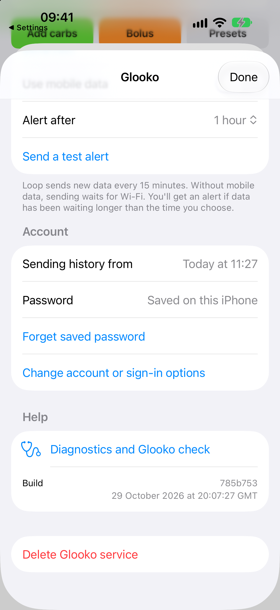</td>
<td>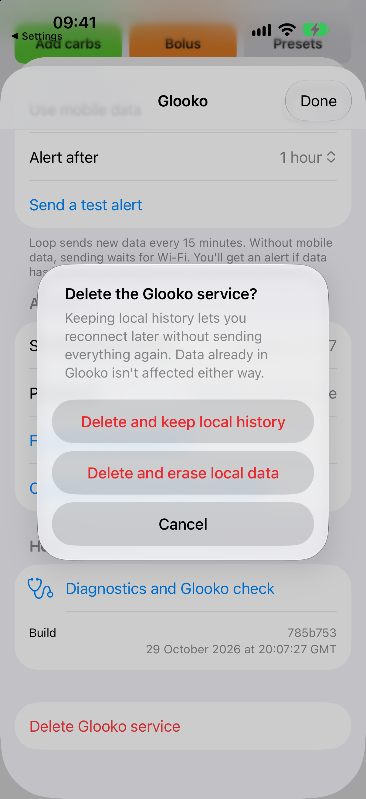</td>
</tr>
</table>

**Account:**
- **Sending history from:** when reporting started for this account.
- **Password:** *Saved on this iPhone* or *Not saved*. **Forget saved password** removes a saved one.
- **Change account or sign-in options:** opens the sign-in screen to switch account or change the options. **Cancel** returns without changing anything.

**Help:**
- **Diagnostics and Glooko check:** see [below](#diagnostics-and-check-glooko-now).
- **Build:** the plugin's Git commit and build time. A `.dirty` suffix means it was built from uncommitted changes.

**Delete Glooko service** offers two ways to delete. See [Credentials, privacy and removal](#credentials-privacy-and-removal).

## Diagnostics and Check Glooko now

<table>
<tr><th>Check and insulin</th><th>Glucose, carbs and settings</th><th>Recent activity</th></tr>
<tr>
<td>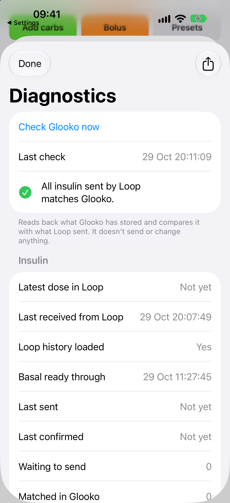</td>
<td>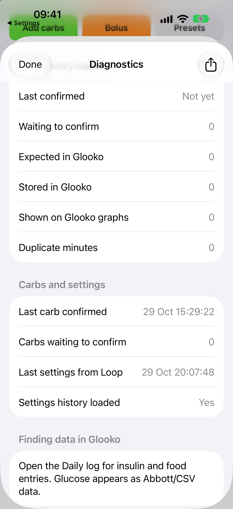</td>
<td>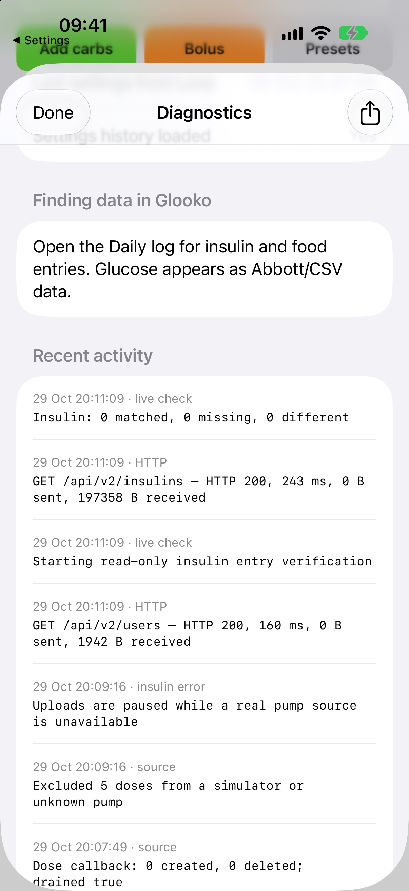</td>
</tr>
</table>

**Check Glooko now** reads back what Glooko has stored and compares it with what Loop sent. It doesn't send, change or acknowledge anything. If a check fails, a warning says so and the counts below are from the previous successful check.

Diagnostics are grouped by data type:

- **Insulin:**
  - From Loop: the latest dose in Loop, when Loop last delivered doses, and whether Loop's dose history has finished loading.
  - Sending: how far basal is ready, last sent, last confirmed and waiting.
  - From the last check: entries **matched**, **missing** or **different** in Glooko.
- **Glucose:**
  - From Loop: when readings last arrived from Loop, and whether its history has finished loading.
  - Sending: last confirmed and waiting.
  - From the last check: readings **expected**, **stored** and **shown on Glooko graphs**, plus **duplicate minutes**.
- **Carbs and settings:** the last carb confirmed, carbs waiting, and when Loop last delivered therapy settings and finished loading them.
- **Recent activity:** the last 250 events, kept for up to 48 hours. Requests record only the address, result, time taken and size. Headers, query parameters, bodies, passwords and cookies are never recorded.

Read the counts, not just the tick. *All insulin sent by Loop matches Glooko* with **0 matched** only shows the connection works; it isn't evidence that a dose was sent. The same goes for zero expected glucose readings. A good check also doesn't prove every Glooko dashboard or clinic report uses the same data.

The share button exports a diagnostic report. It contains health-data times, counts and errors, so check it before you share it.

## Alerts

Loop alerts you when:

- the Glooko session needs you to sign in;
- source history has paused, for example insulin with no real pump;
- eligible data has waited longer than **Alert after**;
- confirmation from Glooko is overdue.

Settling data and streams you've switched off don't count as overdue. Alerts aren't repeated, and they're withdrawn when the problem clears. Background delivery depends on Loop, iOS and your notification settings. **Send a test alert** checks presentation only.

## How uploads work


The service saves each change from Loop before acknowledging it. Nothing is lost if Loop is suspended or restarted.

**Insulin:**
- **Waits for history:** preparation waits until Loop has finished delivering **both** dose and settings history. A page containing data doesn't count as finished.
- **Boluses and basal:** finished boluses become individual entries. Basal delivery is totalled per clock hour, using measured delivered volume when available. A running or still-changing delivery holds back an unfinished hour.
- **Confirmation:** an entry stays queued until Glooko returns it with the expected identity, amount, time, delivery kind, flags and name. An accepted HTTP request alone is not confirmation.
- **Stable identities:** a retry updates the same entry rather than creating a copy. Changes and deletions in Loop are applied to those entries. If a deleted entry is needed again, it gets a new revision, because Glooko doesn't revive a deleted ID.

**Carbs** have their own queue and retries. An edit updates the same food entry, and a deletion soft-deletes it. A failed carb upload retries without needing another change in Loop.

**Glucose** has its own saved queue:
1. It waits for Loop's glucose history to finish loading.
2. It checks which readings Glooko already has.
3. It sends the missing ones as a LibreView-format CSV.
4. A reading is confirmed only when it appears in **both** Glooko's stored CGM records and its graph data.

Replaying an accepted reading doesn't create another copy. A conflicting or duplicate minute is reported for review, not overwritten.

## Insulin names and Loop attribution

Each entry uses the insulin recorded on the original dose. If that's missing, it uses the settings that applied at the time. It never applies today's selection to old doses.

| What Loop recorded | Name in Glooko |
|---|---|
| Fiasp | `Fiasp via Loop` |
| Humalog | `Humalog via Loop` |
| Novolog | `Novolog via Loop` |
| Two known insulins in one basal hour | `Fiasp / Humalog via Loop` |
| A known and an unknown insulin in one hour | `Fiasp / unknown insulin via Loop` |
| No recoverable name | `Insulin via Loop` |

Names follow Loop's selection. The service doesn't guess regional brands or concentrations. A settings fallback that spans a change of insulin stays unknown.

The name is **text**, not a Glooko catalogue medication. Linking to catalogue rapid-acting insulins made Glooko reclassify test basal entries as bolus, so the medication link is deliberately left empty. A **synthetic** delivered-basal record looks like this:

```json
{
  "name": "Fiasp via Loop",
  "insulinType": "basal",
  "medicationGuid": null,
  "deviceDelivered": 1,
  "value": 0.73
}
```

The external identifier is namespaced to Loop as well. Neither the name nor the identifier registers a Loop device in Glooko's device catalogue. The **Pump** row on the status screen is Loop's description of the source, not a Glooko registration.

Glooko controls its own row layout and punctuation; the plugin only supplies the name. Older generic entries held locally are queued for name updates under their existing IDs, amounts and times. Names that were never recorded stay unknown. This is not a rewrite of every older record in the account.

## When data appears

| Data | Earliest it can be sent | Also needs |
|---|---|---|
| Bolus | 10 minutes after it finishes | Final, within the reporting period, from an eligible pump |
| Basal hour | 15 minutes after the hour ends | Delivery evidence up to the hour's end; changing data can delay it |
| Carbs | As soon as Loop delivers the saved change | A connection; retries if needed |
| Glucose | After Loop's glucose history has loaded | **Send glucose** on; the reading passes source and conflict checks |

Automatic insulin sends run at most every **15 minutes** and are driven by Loop's activity, so they don't happen at exact clock times. **Send now** skips that wait, but not the settling and source checks.

Glucose has no settling delay or 15-minute limit. Readings go in batches of up to 500. Failed attempts retry after 30 seconds, backing off to at most 15 minutes, while Loop is running.

Example: reporting starts at **08:20** and a bolus finishes at **08:25**. The bolus can be sent from **08:35**. The partial basal hour **08:20–09:00** can be sent from **09:15**, once its delivery is final.

iOS can suspend Loop. Network, the Wi-Fi-only setting, sign-in state and Loop's own activity can all add delay. Keep Loop running normally; this plugin doesn't replace Loop's background requirements or not-running alerts.

## Find your data in Glooko

- **Insulin and carbs:** open **Daily log**. Carb-only entries are standalone foods, so the web **Diet** panel can stay empty for them.
- **Glucose:** appears on the glucose graphs. Include the **Abbott/CSV** source when filtering. That label comes from Glooko's LibreView importer and doesn't identify the actual sensor.
- **Avoid duplicate glucose:** if a separate CGM connection already sends your readings to Glooko, turn off **Send glucose**.

Glooko [distinguishes device-delivered from manually entered insulin](https://support.glooko.com/hc/en-gb/articles/360001739738-How-is-my-insulin-data-displayed-in-the-Glooko-app), and these entries are marked device-delivered. That still doesn't make them a full pump timeline, a settings report or an official Loop integration.

## Troubleshooting

| What you see | What it means and what to do |
|---|---|
| Glooko missing from Add Service | Recheck the workspace project, the scheme's build target and plugin embedding |
| **Sign in needed** | The session expired. Tap **Sign in** in the header. A saved password can't get past every account or sign-in challenge |
| **Some data can't be sent** | Read the warning in the stream's section; Diagnostics shows the detail |
| Insulin warning: *real pump source is unavailable* | Expected with the Pump Simulator or an unknown pump. Use a real pump for insulin. Carbs and glucose still work |
| **Pump: Waiting for a pump** after relaunch | Check the host integration's restored-device snapshot. Don't disguise the source by changing a manufacturer string |
| Signed in, but zero entries | Check **Sending history from**, settling times and the *history loaded* rows in Diagnostics, and whether there is any eligible delivery |
| Diagnostics: *Loop history loaded: No* | The host must finish both queries, including their empty final callbacks. See the host integration guide |
| On Wi-Fi only and nothing moves | Wait for Wi-Fi or turn on **Use mobile data**. Low Data Mode is never used |
| Sent but not confirmed | The entry stays waiting. Check Recent activity; an HTTP success alone isn't enough |
| Glucose shows as Abbott/CSV with a Dexcom | Expected: the CSV route can't keep the native sensor identity |
| Glucose waiting, or a conflicting minute | Check history loading, network and Diagnostics. A different or duplicate reading in Glooko isn't overwritten; check for other uploaders |
| Food visible but Diet empty | Standalone carb foods appear in Daily log and graphs without filling the Diet panel |
| Older summaries differ | Check the date range and older imported sources. This plugin doesn't certify or repair historical Glooko summaries |

## Credentials, privacy and removal

**Sign-in and passwords:**
- New sign-ins save a session. Saving the password is opt-in through **Save password on this iPhone**, and existing installations keep their previous choice.
- **Forget saved password** removes a saved password.
- Credentials are stored per account in the iOS Keychain. They are available after first unlock, kept on this device only and never synced through iCloud.
- A saved password can be read by this app and sent to Glooko again to restore a session.
- There is no registered OAuth client. Sign-in uses Glooko's patient-app session API.
- A rejected password, account restrictions, two-step sign-in or a missing saved password all require you to sign in yourself.
- Automatic password retries are rate-limited and shared between the insulin, glucose and carb senders.

**Local storage:** upload history and diagnostics are kept in the app's protected, per-account storage. A new account gets separate history. If storage can't be read, Loop says so; confirmed history is never silently replaced with an empty queue.

**Delete Glooko service** offers:

- **Delete and keep local history:** stops the service and removes its credentials, but keeps Loop's record of what was sent. You can reconnect later without sending everything again.
- **Delete and erase local data:** after a second confirmation, erases this plugin's history, archives, diagnostics and saved sign-in from the app. It can't be undone.

Neither option touches data in Glooko or Loop's own records. Turning off **Send insulin** or **Send glucose** keeps that stream's queued data.

## Limits and historical uploads

- **Delivered doses only:** this reports delivered doses. It is not a full copy of Loop or a pump download. Glooko gets no basal-rate, temporary-basal, suspension, automation or settings timeline this way.
- **Bolus and basal detail:** zero-delivery hours are left out. Manual and automatic boluses are both ordinary bolus entries.
- **Rounding:** amounts are sent to three decimal places. Glooko may round graphs and summaries further, so confirmed records and displayed totals can differ slightly.
- **Travel and clock changes:** time-zone changes and repeated local times around clock changes aren't fully reconstructed in history.
- **How far back:** only history Loop still holds, plus locally kept upload records, can be recovered. The insulin and glucose queues keep about 14 days and protect unconfirmed work.
- **Other uploaders:** records already imported stay in Glooko. Data from separately connected uploaders isn't deduplicated against these entries.
- **Glucose CSV:** times are to the minute. Corrections, and repeated clock minutes with different offsets, can't be represented safely; a conflict stops confirmation for that page. Values are sent to 0.01 mg/dL, and the originals stay in local storage.
- **Glucose source label:** glucose shows as Abbott/CSV in Glooko, even for Dexcom. No route that keeps the native source has been found: the patient API's CGM PUT route returned "Not available".
- **Not uploaded:** manual injections, meal descriptions, insulin concentrations and catalogue medication links.
- **Not supported:** other Glooko regions, two-step sign-in and a supported public OAuth write route.

Earlier versions sent insulin through a virtual Omnipod/IBF route. **The current service doesn't use that route.** The remaining Omnipod/IBF code only reads old stored history and handles migration:

- Insulin cut-over starts where the old route stopped, or at its unsent history start, so the same delivery isn't counted twice.
- Older native pump records keep their original labels and may appear in Glooko under *Insulet Omnipod System*.
- Glucose uses a new protected queue, separate from the retired glucose cache.

## Developer reference

| Path | Role |
|---|---|
| `GlookoKit/InsulinOutbox.swift` | Delivered-volume totals, saved insulin queue, names, amendments and exact readback |
| `GlookoKit/GlucoseOutbox.swift` | Saved CGM queue, replay and conflict checks, CSV sending, record and graph readback |
| `GlookoKit/CarbOutbox.swift` | Food identities, changes, deletion, confirmation and older meal migration |
| `GlookoKit/GlookoClient.swift`, `SyncReader.swift` | Session transport and complete paginated reads |
| `GlookoKit/SyncHealth.swift`, `SyncDiagnostics.swift` | Alert state and bounded diagnostic history |
| `GlookoServiceKit/ReportingContext.swift` | LoopKit dose and settings adapter, source identity and recorded insulin name |
| `GlookoServiceKit/GlookoService.swift` | Lifecycle, account binding, history loading, send scheduling and credential recovery |
| `GlookoServiceKitUI/GlookoService+UI.swift` | Sign-in, status screen, status header and the shared warning style |
| `GlookoServiceKitUI/DiagnosticsView.swift` | Diagnostics, Check Glooko now and the shareable report |
| `GlookoServiceKitPlugin/` | Loop plugin discovery and principal class |
| `Tests/GlookoKitTests/` | Standalone core tests |
| `Tests/GlookoServiceKitTests/` | iOS service, persistence, Keychain and intercepted-transport tests |
| `Documentation/Loop/` | Current next-dev host integration and the historical dev patch |

### UI conventions

- The screens are a native grouped form that matches Loop's other services.
- Every problem uses one `GlookoWarning` view: a red triangle with plain text. Red means a warning only. Orange is avoided because Loop uses it for insulin.
- Accessibility identifiers (`glooko-health`, `glooko-insulin-enabled`, `glooko-glucose-enabled`, `glooko-upload-now`, `glooko-live-check` and so on) are kept stable for UI automation.

### Request identity

Requests identify this project honestly:

```http
User-Agent: Loop-GlookoService (+https://github.com/Nutcasey/GlookoService)
```

What the client never sends:
- a `deviceInformation` header or login-body field;
- a made-up device ID or serial;
- a Glooko app version, build number or Git hash;
- the Glooko website's `Origin` or `Referer`, including on glucose CSV uploads.

The login body carries the account credentials under the endpoint's `user` or `userLogin` key.

Write routes:
- `PUT /api/v2/insulins`
- `PUT /api/v2/foods`
- `POST /api/v3/device/file/upload?extractorName=LibreviewCSV` for glucose

A sync-complete request follows each submission. Legacy meal records can be retired during carb migration.

### Building and testing

For the standalone core:

```sh
swift test
```

For the iOS adapter:
1. Build the matching workspace products first.
2. Run the **GlookoServiceTests** scheme on a simulator. Its host intercepts HTTP and never contacts a real Glooko account.

Simulated Keychain access needs a suitably signed test host; ad hoc simulator signing was used for the documented runs.

`project.yml` is the XcodeGen source. After adding source files, regenerate `GlookoService.xcodeproj` and include it in the change. The UI framework records its own Git commit, dirty flag and build date, which appear under **Help → Build**.

## Verification

Recorded on **29 October 2026**:

| Area | Evidence |
|---|---|
| Core | 42 passing tests: request identity, names, original amounts, persistence and old-cache upgrades |
| iOS service | 14 passing integration tests: default-on glucose, disabling and restart persistence, Dexcom/Libre units, source filtering, history loading, cancellation, retry and damaged storage, alongside insulin and carbs. Rerun after the settings redesign with 0 failures |
| Isolated live API | Names added to existing entries, replay without duplicates, a synthetic name corrected and cleanup verified |
| Simulator workflow | Sign-in, cancellation, alerts, carb create/edit/delete, repeated sending, restart recovery and simulator-insulin exclusion |
| Settings redesign | Every screen exercised on the `loop` simulator: insulin on/off with the pump guard, live check, expired-session header, delete dialogue (cancelled), sign-in, light and dark mode |
| Device | Ultimate iPhone (Omnipod 5, Dexcom G7): 91 glucose readings matched stored records and graphs with no duplicates, and all 21 insulin entries matched. After the redesign: *Up to date*, 22 insulin entries, glucose current, closed loop unaffected |
| Glucose live API | Two synthetic readings matched in raw CGM records and graphs; replay made no duplicates and all 12 existing readings were unchanged |

The two synthetic CGM points stay in the isolated test account, because deleting individual CGM points through this importer isn't established. No synthetic glucose is sent to the clinical account.

Work records with full detail:
- [Simulator validation](.log/261029-1538-simulator-end-to-end-validation.md): the carb cycle reused one Glooko food ID through 27 g → 34 g → deletion, and all 227 existing insulin and 14 food records were unchanged.
- [Phone deployment](.log/261029-1635-ultimate-iphone-deployment.md): the honest request identity, with all 20 existing insulin entries matched on the phone.
- [Glucose deployment](.log/261029-1809-glucose-on-ultimate-iphone.md): at 18:07:39 GMT a read-only check matched 91 real readings in records and graphs, with 0 duplicate minutes, and 21 insulin entries.
- [Settings redesign](.log/261029-1909-settings-ui-clarity-pass.md): what changed on each screen, how it was tested and how it was deployed.

Tests with catalogue-linked rapid-acting insulin showed unwanted basal-to-bolus reclassification. Text-only names with no medication link kept both delivery kinds correct in raw records, graphs and the tested statistics.

These checks don't certify every pump, region, background state, historical date or Glooko report. Glooko controls its own row layout; what the plugin verifies is the uploaded name and delivery data.

See the [work records](.log/) for decisions and tested contracts, and the [screenshot provenance](Documentation/Screenshots/README.md) for capture details.

## Licence and artwork

Code is available under the [MIT licence](LICENSE). Glooko and Loop names and artwork belong to their owners. The service icon comes from Glooko's [App Store listing](https://apps.apple.com/gb/app/glooko-track-diabetes-data/id471942748). The unmodified Loop artwork notice is in [LoopArtwork-LICENSE.txt](GlookoServiceKitUI/LoopArtwork-LICENSE.txt).
